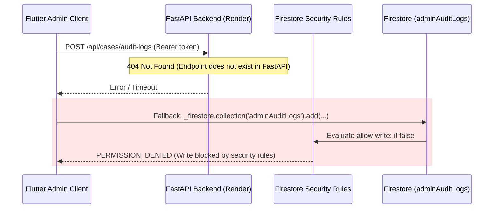
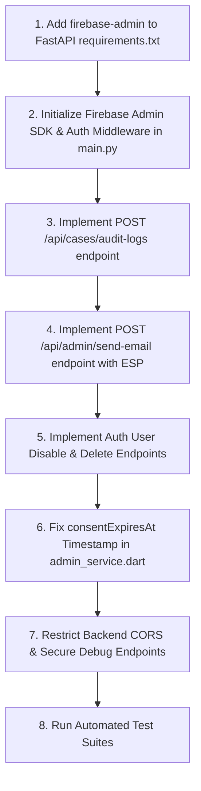

# LittleLumin — Technical Architecture & Admin Feature Audit

> **Target Audience:** Engineering Team & AI Coding Assistants (ChatGPT / Claude / Antigravity)  
> **Status:** Inspection-Only Audit  
> **Repository:** `LittleLumin` (Flutter Web/Mobile + FastAPI Backend)  
> **Date:** October 2026  
> **Compliance Standard:** DPDP (Digital Personal Data Protection Act) & Least Privilege Role-Based Access Control

---

## 1. Architecture Summary

### 1.1 Core Technology Stack

| Layer | Technology | Version / Configuration | Hosting / Environment |
|---|---|---|---|
| **Frontend Client** | Flutter / Dart | Dart SDK `>=3.3.0 <4.0.0` / Material 3 | Firebase Hosting (Web), Android, iOS, Windows, macOS |
| **Backend Microservices** | Python / FastAPI | FastAPI `0.104.1`, Uvicorn `0.24.0`, Pydantic `2.7.4` | Render (`littlelumin-backend.onrender.com`) via `backend/render.yaml` |
| **Primary Database** | Cloud Firestore | Rules Version 2 (`firestore.rules`, 628 lines) | Google Cloud / Firebase (`littlelumin-e7d26`) |
| **Secondary Database** | Firebase Realtime Database | Configured in `.env` (`FIREBASE_DATABASE_URL`) | Google Cloud / Firebase |
| **Authentication** | Firebase Authentication | Email/Password, Google Sign-In (`google_sign_in: ^6.2.2`) | Firebase Auth |
| **AI Generation Engine** | Google Gemini | `google-generativeai==0.8.3` (`gemini-3.6-flash`) | Backend service (`backend/app/services/openai_service.py`) |
| **Reporting / Export** | Dart `pdf` & `printing` | `pdf: ^3.13.1`, `printing: ^5.15.1` | Client-side multiformat PDF & RFC-compliant CSV |

---

### 1.2 Administrative Directory Structure

```
LittleLumin/
├── backend/                              # Python FastAPI Microservice
│   ├── app/
│   │   ├── main.py                       # FastAPI entry point, CORS, health & debug routes
│   │   ├── routes/
│   │   │   └── ai_routes.py              # POST /api/ai/generate-activity, /generate-story
│   │   └── services/
│   │       └── openai_service.py         # Google Gemini generative service wrapper
│   ├── render.yaml                       # Render web service deployment configuration
│   └── requirements.txt                  # Python package specifications (fastapi, uvicorn, pydantic, etc.)
│
├── lib/
│   ├── models/
│   │   ├── admin_models.dart             # AccountStatus, Warning, Recovery, Assignment, EmailLog, Report, Health
│   │   ├── user_model.dart               # UserModel with status flags and warnings array
│   │   └── specialist_case_model.dart    # DPDP consent case model with categories and expiry
│   │
│   ├── screens/
│   │   ├── admin/
│   │   │   ├── admin_dashboard.dart      # Main responsive Admin Shell (7 grouped navigation modules)
│   │   │   └── views/
│   │   │       ├── admin_overview_view.dart            # KPI metric cards, fl_chart distribution, pending queue
│   │   │       ├── admin_user_management_view.dart     # User directory, filters, drawer, warning/suspension/deletion
│   │   │       ├── admin_llg_management_view.dart      # Specialist directory, verification queue, assignments
│   │   │       ├── admin_activity_management_view.dart # Activities library, AI review queue, preset seeder
│   │   │       ├── admin_communication_view.dart       # Notification center, email delivery logs, support
│   │   │       ├── admin_analytics_reports_view.dart   # 9-category report generator, CSV & PDF export
│   │   │       └── admin_security_health_view.dart     # Immutable audit log viewer, live diagnostics
│   │
│   ├── services/
│   │   ├── admin_service.dart            # Authoritative admin operations, user lifecycle, assignments, health
│   │   ├── admin_report_service.dart     # Report data synthesis, CSV formatter, multi-page PDF generation
│   │   ├── email_service.dart            # Branded HTML email generation, emailLogs tracking, retry logic
│   │   ├── audit_log_service.dart        # HTTP dispatcher for backend audit trail
│   │   ├── llg_service.dart              # Specialist applications, approveLLG, rejectLLG
│   │   └── auth_service.dart             # Firebase Auth wrapper, role resolution
│   │
│   └── firebase_options.dart             # Platform Firebase configuration reading from .env
│
├── firestore.rules                       # 628 lines of strict security & DPDP compliance rules
├── firebase.json                         # Firebase project & emulator configurations (Firestore port 8080)
└── test/
    ├── admin_portal_workspace_test.dart  # Unit tests for models, CSV generation, health status
    ├── specialist_llg_workspace_test.dart
    ├── specialist_child_profile_and_case_management_test.dart
    └── firestore_security_rules_test.js  # 1061-line security rules test suite for Firestore Emulator
```

---

## 2. Existing User Management Implementation

### 2.1 Capability Audit

| Feature | Implemented In | Function / Method | Backend Endpoint / Mechanism | Status & Deficiencies |
|---|---|---|---|---|
| **Listing & Filtering Users** | `lib/screens/admin/views/admin_user_management_view.dart` | `AdminService.getUsersStream()` | Cloud Firestore `users` collection stream | **Functional in client**. Supports search by name, email, UID, and filtering across 6 tabs (`all`, `parent`, `children`, `llg`, `suspended`, `recovery_pending`). |
| **Issue Warning** | `lib/services/admin_service.dart` | `issueWarning()` | Updates `users/{uid}`, writes `warnings` array, calls `EmailService.sendAdminEmail()` | **Functional in client & Firestore**. Dispatches in-app notification. *External email relies on backend fallback*. |
| **Suspend Account** | `lib/services/admin_service.dart` | `suspendAccount()` | Updates `users/{uid}` with `status: 'suspended'`, `suspensionReason`, `reviewDate` | **Firestore status updated**. Does *not* revoke Firebase Auth session tokens or disable user in Firebase Authentication. |
| **Restore Account** | `lib/services/admin_service.dart` | `restoreAccount()` | Sets `users/{uid}` status to `'active'`, records `restoredAt` | **Functional in Firestore**. Sends notification to user. |
| **Account Recovery** | `lib/services/admin_service.dart` | `submitRecoveryRequest()`, `processRecoveryDecision()` | Collection `accountRecoveryRequests` | **Functional**. Allows Approve, Reject, or Additional Verification with reviewer notes. |
| **Deactivate Account** | `lib/services/admin_service.dart` | `deactivateAccount()` | Updates `users/{uid}` with `status: 'deactivated'` | **Functional in Firestore**. Soft-disable. |
| **Permanent Deletion** | `lib/services/admin_service.dart` | `permanentlyDeleteAccountSafeguard()` | Detaches child records (`isParentDeleted: true`), revokes active cases, deletes `users/{uid}` | **Partial**. Deletes Firestore document and cleans dependencies, but **cannot delete the Firebase Auth user record** without backend Firebase Admin SDK. |

### 2.2 Account Status Model

The lifecycle is defined in [`lib/models/admin_models.dart`](file:///c:/Project/LittleLumin/lib/models/admin_models.dart) via `AccountStatus`:
- `ACTIVE` (`active`)
- `WARNING_ISSUED` (`warning_issued`)
- `SUSPENDED` (`suspended`)
- `RECOVERY_PENDING` (`recovery_pending`)
- `DEACTIVATED` (`deactivated`)
- `DELETION_PENDING` (`deletion_pending`)

### 2.3 Firebase Authentication vs. Firestore Synchronization Gap

> [!WARNING]
> **Client-Side Firebase Auth Limitations:**  
> The Flutter client SDK cannot disable or delete other users' Firebase Authentication accounts (e.g. `auth.updateUser(uid, disabled=True)` or `auth.deleteUser(uid)`).  
> Consequently, when an administrator "Suspends" or "Deletes" a user in the Admin Portal, the user document in Firestore is updated/deleted, but the Firebase Auth credential remains valid unless revoked by a server process running the Firebase Admin SDK.

---

## 3. Existing Parent–LLG Assignment Management

### 3.1 Entity Representation

- **Parents**: Documents in `users/{parentId}` where `userType == 'parent'`.
- **Children**: Documents in `children/{childId}` where `parentId == parentId`.
- **Specialists (LLG Guides)**:
  - Document in `users/{specialistId}` where `userType == 'llg'` or `'specialist'` and `isVerified == true`.
  - Profile in `llgProfiles/{specialistId}` containing credentials, licenses, specializations, and `verificationStatus == 'approved'`.

### 3.2 Assignment Storage & Data Structures

Assignments are tracked in two Firestore collections:

1. **`llgAssignments` Collection**:
   - `id`: Unique assignment identifier (auto-generated document ID).
   - `parentId`: Parent's UID.
   - `parentName`: Parent display name.
   - `childId`: Covered child UID (optional if family-level).
   - `childName`: Covered child name.
   - `specialistId`: Assigned specialist UID.
   - `specialistName`: Specialist display name.
   - `specialistRole`: Specialization (e.g., Clinical, Speech, Occupational).
   - `status`: `'active'`, `'reassigned'`, or `'removed'`.
   - `assignedAt`: Timestamp of assignment.
   - `assignedBy`: Admin UID who executed the assignment.
   - `reason`: Administrative justification.
   - `coveredChildren`: Array of child IDs covered under this assignment.
   - `endedAt`, `reassignmentReason`, `removalReason`: Lifecycle closure metadata.

2. **`specialistCases` Collection (DPDP Consent Gating)**:
   - Deterministic ID: `${childId}_${specialistId}`.
   - Fields: `caseId`, `parentId`, `childId`, `specialistId`, `status` (`'pending'`, `'accepted'`, `'active'`, `'completed'`, `'revoked'`), `authorizedDataCategories` (`['all', 'domain_scores', 'activity_history', 'observations']`), `consentNoticeVersion` (`'v1.0-dpdp'`), `consentExpiresAt` (Timestamp).

### 3.3 Assignment Functions & Code Inventory

- **Create Assignment**: [`AdminService.assignSpecialistToParent()`](file:///c:/Project/LittleLumin/lib/services/admin_service.dart#L445-L539)  
  *Flow:* Validates target specialist `isVerified == true` -> writes `llgAssignments` doc -> writes/activates `specialistCases` doc -> sends branded notification -> logs audit trail.
- **Reassign Specialist**: [`AdminService.reassignSpecialist()`](file:///c:/Project/LittleLumin/lib/services/admin_service.dart#L542-L604)  
  *Flow:* Verifies new specialist -> updates old assignment `status: 'reassigned'` -> revokes old `specialistCases` doc -> creates new assignment record -> logs audit trail.
- **Remove Specialist**: [`AdminService.removeSpecialistAssignment()`](file:///c:/Project/LittleLumin/lib/services/admin_service.dart#L607-L638)  
  *Flow:* Updates `llgAssignments` doc `status: 'removed'` -> revokes `specialistCases` doc with reason -> logs audit trail.
- **Assignment History**: [`AdminService.getAssignmentsHistoryStream()`](file:///c:/Project/LittleLumin/lib/services/admin_service.dart#L679-L695) provides an ordered historical audit stream.

> [!IMPORTANT]
> **Firestore Rules Discrepancy in Direct Admin Assignment:**  
> In [`lib/services/admin_service.dart:507`](file:///c:/Project/LittleLumin/lib/services/admin_service.dart#L507), the code writes `'expiresAt': now.add(const Duration(days: 90))`.  
> However, [`firestore.rules:64-66`](file:///c:/Project/LittleLumin/firestore.rules#L64-L66) specifically checks:  
> `get(...).data.get('consentExpiresAt', null) != null && get(...).data.get('consentExpiresAt', null) is timestamp`  
> Direct administrative assignment must include `'consentExpiresAt': Timestamp.fromDate(...)` so specialists can read child records without security rule denials.

---

## 4. Backend Security and Authentication

### 4.1 FastAPI Backend Inspection

Inspection of `backend/app/main.py`, `backend/requirements.txt`, and `backend/render.yaml` confirms:

1. **Firebase Admin SDK:** **NOT installed or initialized.**
   - `requirements.txt` contains:
     ```text
     fastapi==0.104.1
     uvicorn==0.24.0
     pydantic==2.7.4
     google-generativeai==0.8.3
     python-dotenv==1.0.0
     ```
   - `firebase-admin` is completely absent from the backend.
2. **Token Verification:**
   - There is **no ID token verification middleware** or dependency in FastAPI.
   - Any client can query existing endpoints without authentication headers.
3. **CORS Configuration:**
   - In `backend/app/main.py`:
     ```python
     app.add_middleware(
         CORSMiddleware,
         allow_origins=["*"],
         allow_credentials=True,
         allow_methods=["*"],
         allow_headers=["*"],
     )
     ```
   - All origins, methods, and headers are permitted wildcard access.
4. **Exposed Diagnostic Endpoints:**
   - `GET /debug/models` in `backend/app/main.py` lists Gemini models using `GEMINI_API_KEY`. While it does not print the key, it allows unauthenticated callers to inspect configured AI capabilities.

### 4.2 Role & Permission Enforcement in Firestore Rules

In [`firestore.rules`](file:///c:/Project/LittleLumin/firestore.rules):
```javascript
function isAdmin() {
  return isAuthenticated() && (
    request.auth.token.get('admin', false) == true ||
    request.auth.token.get('role', '') == 'admin' ||
    exists(/databases/$(database)/documents/adminUsers/$(request.auth.uid))
  );
}
```
- **Strengths:**  
  - Explicitly refuses to trust client-editable fields on `users/{uid}`.
  - Requires either Firebase Auth Custom Claims (`admin: true`) or an explicit document in `adminUsers/{uid}`.
  - Prevents privilege escalation during self-registration (`users` create rule prohibits setting `role`, `admin`, or `isVerified`).
- **Operational Gap:**  
  - Because the Python backend lacks `firebase-admin`, there is no automated API to grant custom claims (`auth.set_custom_user_claims(uid, {'admin': True})`).  
  - Currently, an administrator must be manually provisioned by creating an entry in the `adminUsers` Firestore collection.

---

## 5. Firestore Rules & Audit Logging

### 5.1 Audit Log Security Lockdown

[`firestore.rules:451-457`](file:///c:/Project/LittleLumin/firestore.rules#L451-L457):
```javascript
match /adminAuditLogs/{logId} {
  // Authoritative audit integrity: Deny ALL client SDK writes (including administrator clients)
  // to guarantee audit records cannot be forged or tampered with by any client application.
  // Audit records are written exclusively through trusted backend operations with verified tokens.
  allow read: if isAdmin();
  allow write: if false;
}
```

### 5.2 The Audit Logging Disconnect



- **In Flutter**: [`AuditLogService.logEvent()`](file:///c:/Project/LittleLumin/lib/services/audit_log_service.dart#L14-L45) attempts to dispatch audit entries to `https://littlelumin-backend.onrender.com/api/cases/audit-logs`.
- **In Backend**: The route `/api/cases/audit-logs` **does not exist** in `backend/app/main.py`.
- **Fallback**: [`AdminService.logAdminAudit()`](file:///c:/Project/LittleLumin/lib/services/admin_service.dart#L761) falls back to direct client write to `adminAuditLogs`, which is **blocked by security rules (`allow write: if false;`)**.
- **Result**: Client-initiated audit events currently fail silently and cannot be recorded in `adminAuditLogs` until the backend endpoint is implemented.

---

## 6. Email and Notifications

### 6.1 Email Dispatch Mechanism

- **Configured ESP**: **None.** No external transactional email provider (such as Resend, SendGrid, Mailgun, AWS SES, or SMTP) is configured in `.env` or in the backend.
- **Client Behavior**: [`EmailService.sendAdminEmail()`](file:///c:/Project/LittleLumin/lib/services/email_service.dart#L57-L162) compiles a styled HTML email template and attempts to post to `https://littlelumin-backend.onrender.com/api/admin/send-email`.
- **Fallback Behavior**:
  1. The HTTP request to `/api/admin/send-email` fails (route does not exist in FastAPI).
  2. The service catches the exception and logs an entry to Firestore `emailLogs` with an `OFFLINE-...` or `MOCK-...` message ID.
  3. The service writes a mirror notification into Firestore `notifications` collection (`userId`, `title`, `message`, `type: 'admin_$category'`, `read: false`).
- **Conclusion**: **Emails are recorded in Firestore and delivered as in-app notifications, but no actual external email is delivered to user inboxes.**

---

## 7. Missing Features & Security Gaps

### Summary Table

| ID | Category | Severity | Finding / Gap | Recommended Fix |
|---|---|---|---|---|
| **GAP-01** | Backend / Auth | **Critical** | `firebase-admin` is missing from `backend/requirements.txt`. Backend cannot verify tokens or manage Auth users. | Add `firebase-admin` to backend, initialize credentials, and implement token verification dependency. |
| **GAP-02** | Security / Audit | **Critical** | `POST /api/cases/audit-logs` does not exist in FastAPI. Because Firestore rules block client writes (`allow write: if false;`), admin audit events fail to persist. | Implement `/api/cases/audit-logs` in FastAPI with Admin SDK privileged writes to `adminAuditLogs`. |
| **GAP-03** | Email Delivery | **High** | `POST /api/admin/send-email` does not exist in FastAPI. No ESP (Resend/SendGrid/SMTP) is integrated. | Add Resend / SendGrid / SMTP dispatch route in FastAPI and update `EmailService`. |
| **GAP-04** | User Lifecycle | **High** | Permanent deletion and suspension only modify Firestore; Firebase Auth users remain active/enabled. | Implement backend endpoints `POST /api/admin/users/{uid}/suspend` and `DELETE /api/admin/users/{uid}` using `firebase_admin.auth`. |
| **GAP-05** | Firestore Rules | **Medium** | Direct admin assignment in `admin_service.dart:507` writes `'expiresAt'` instead of `'consentExpiresAt'` Timestamp. | Write both `'consentExpiresAt': Timestamp.fromDate(...)` and `'expiresAt'` in `assignSpecialistToParent()`. |
| **GAP-06** | API Security | **Medium** | FastAPI CORS uses `allow_origins=["*"]` with `allow_credentials=True`. Diagnostic `/debug/models` is publicly exposed. | Restrict CORS to trusted app domains and protect `/debug/models` behind admin token auth. |
| **GAP-07** | Role Management | **Low** | No automated endpoint to set `admin: true` custom claims on user tokens. | Implement a protected admin CLI script or backend endpoint `POST /api/admin/grant-role`. |

---

## 8. Exact Files ChatGPT Needs to Review

### 8.1 Backend (Python FastAPI)

1. [`backend/requirements.txt`](file:///c:/Project/LittleLumin/backend/requirements.txt): Needs `firebase-admin`, `httpx`, and email provider SDK (e.g. `resend` or `sendgrid`).
2. [`backend/app/main.py`](file:///c:/Project/LittleLumin/backend/app/main.py): Needs Firebase Admin SDK initialization, auth dependency, CORS restrictions, and inclusion of new admin routers.
3. [`backend/app/routes/admin_routes.py`](file:///c:/Project/LittleLumin/backend/app/routes/admin_routes.py) *(to be created)*: Endpoints for audit logging (`/api/cases/audit-logs`), transactional email (`/api/admin/send-email`), and Auth user suspension/deletion.
4. [`backend/render.yaml`](file:///c:/Project/LittleLumin/backend/render.yaml): Needs environment variable bindings for `FIREBASE_SERVICE_ACCOUNT` and email API keys.

### 8.2 Frontend (Flutter Dart)

1. [`lib/services/admin_service.dart`](file:///c:/Project/LittleLumin/lib/services/admin_service.dart):
   - Review lines 488–510 (`consentExpiresAt` Timestamp fix in `specialistCases`).
   - Review lines 357–438 (Permanent deletion workflow to trigger backend Auth deletion).
2. [`lib/services/email_service.dart`](file:///c:/Project/LittleLumin/lib/services/email_service.dart):
   - Review lines 85–125 (Dispatch payload contract for `/api/admin/send-email`).
3. [`lib/services/audit_log_service.dart`](file:///c:/Project/LittleLumin/lib/services/audit_log_service.dart):
   - Review lines 14–45 (Verify request structure sent to `/api/cases/audit-logs`).
4. [`lib/screens/admin/admin_dashboard.dart`](file:///c:/Project/LittleLumin/lib/screens/admin/admin_dashboard.dart):
   - Shell routing and navigation state management.
5. [`lib/screens/admin/views/admin_user_management_view.dart`](file:///c:/Project/LittleLumin/lib/screens/admin/views/admin_user_management_view.dart):
   - Dialog flows for Issue Warning, Suspend, Restore, Process Recovery, and Delete Safeguard.
6. [`lib/screens/admin/views/admin_llg_management_view.dart`](file:///c:/Project/LittleLumin/lib/screens/admin/views/admin_llg_management_view.dart):
   - Specialist verification queue, split-panel credential preview, and assignment modal.

---

## 9. Recommended Implementation Order for ChatGPT



### Phase 1: Backend Foundation & Auth Middleware
1. Add `firebase-admin` and `resend` (or SendGrid/SMTP) to `backend/requirements.txt`.
2. In `backend/app/main.py`:
   - Initialize `firebase_admin.initialize_app()`.
   - Create a FastAPI dependency `get_current_admin(credentials: HTTPAuthorizationCredentials)` that verifies the ID token using `firebase_admin.auth.verify_id_token(token)` and checks for `admin: true` or membership in `adminUsers`.

### Phase 2: Authoritative Audit Logging & Email Endpoints
1. Create `backend/app/routes/audit_routes.py`:
   - Implement `POST /api/cases/audit-logs`.
   - Verify caller token, extract UID and email, and use `firestore.client().collection('adminAuditLogs').add(...)` to write audit records with server timestamps.
2. Create `backend/app/routes/email_routes.py`:
   - Implement `POST /api/admin/send-email`.
   - Call the configured ESP to send the HTML email, record the provider message ID, and update Firestore `emailLogs`.

### Phase 3: Firebase Auth User Lifecycle Synchronization
1. Create `backend/app/routes/user_admin_routes.py`:
   - `POST /api/admin/users/{uid}/suspend`: Calls `auth.update_user(uid, disabled=True)` and revokes refresh tokens via `auth.revoke_refresh_tokens(uid)`.
   - `POST /api/admin/users/{uid}/restore`: Calls `auth.update_user(uid, disabled=False)`.
   - `DELETE /api/admin/users/{uid}`: Calls `auth.delete_user(uid)`.

### Phase 4: Flutter Client Polish
1. In `lib/services/admin_service.dart`:
   - Fix `assignSpecialistToParent()` to explicitly pass `'consentExpiresAt': Timestamp.fromDate(expiresAt)`.
   - Route suspension, restoration, and deletion actions to the new backend endpoints.

---

## 10. Testing and Deployment Considerations

### 10.1 Existing Automated Tests

- **Flutter Workspace Tests**:
  - `flutter test test/admin_portal_workspace_test.dart` (Validates admin models, CSV serializer, and health checks).
  - `flutter test test/specialist_llg_workspace_test.dart` (Validates reports, PDF generation, specialist messaging).
  - `flutter test test/specialist_child_profile_and_case_management_test.dart` (Validates DPDP consent badges, tab navigation).
- **Firestore Security Rules Tests**:
  - `test/firestore_security_rules_test.js` (1061 lines testing 12 distinct security domains against Firestore Emulator).
- **Selenium End-to-End Tests**:
  - Located in `selenium_tests/` (executed via `pytest selenium_tests/`).

### 10.2 Test Execution Commands

```bash
# 1. Run Flutter static analysis
flutter analyze

# 2. Run Admin Portal unit and model tests
flutter test test/admin_portal_workspace_test.dart

# 3. Run all unit and widget tests
flutter test

# 4. Run Firestore Emulator Security Rules test suite
firebase emulators:exec --only firestore "node test/firestore_security_rules_test.js"

# 5. Run Backend Pytest suite (when Python environment active)
cd backend && pytest tests/ -v
```

### 10.3 Required Environment Variables (Names Only)

#### Backend (`backend/.env` / Render Dashboard)
- `PORT`: Server port (default `8000`).
- `HOST`: Bind address (default `0.0.0.0`).
- `GEMINI_API_KEY`: API key for Google Gemini model generation.
- `FIREBASE_SERVICE_ACCOUNT_KEY` *(Required for Admin SDK)*: Path or JSON string for Firebase service account credentials.
- `RESEND_API_KEY` or `SENDGRID_API_KEY` *(Required for external email)*: Transactional email service API key.
- `EMAIL_FROM_ADDRESS` *(Required for external email)*: Verified sender address (e.g., `no-reply@littlelumin.com`).

#### Frontend (`.env` / Flutter Build Environment)
- `FIREBASE_PROJECT_ID`
- `FIREBASE_MESSAGING_SENDER_ID`
- `FIREBASE_DATABASE_URL`
- `FIREBASE_STORAGE_BUCKET`
- `FIREBASE_AUTH_DOMAIN`
- `FIREBASE_WEB_API_KEY`
- `FIREBASE_WEB_APP_ID`
- `FIREBASE_WEB_MEASUREMENT_ID`
- `FIREBASE_ANDROID_API_KEY`
- `FIREBASE_ANDROID_APP_ID`
- `FIREBASE_ANDROID_CLIENT_ID`
- `FIREBASE_IOS_API_KEY`
- `FIREBASE_IOS_APP_ID`
- `FIREBASE_IOS_CLIENT_ID`
- `FIREBASE_IOS_BUNDLE_ID`
- `FIREBASE_WINDOWS_API_KEY`
- `FIREBASE_WINDOWS_APP_ID`
- `FIREBASE_WINDOWS_MEASUREMENT_ID`
- `API_BASE_URL` (`https://littlelumin-backend.onrender.com`)

---

*Report prepared and verified from codebase inspection.*  
*Artifact saved as `LITTLELUMIN_TECHNICAL_AUDIT.md`.*
